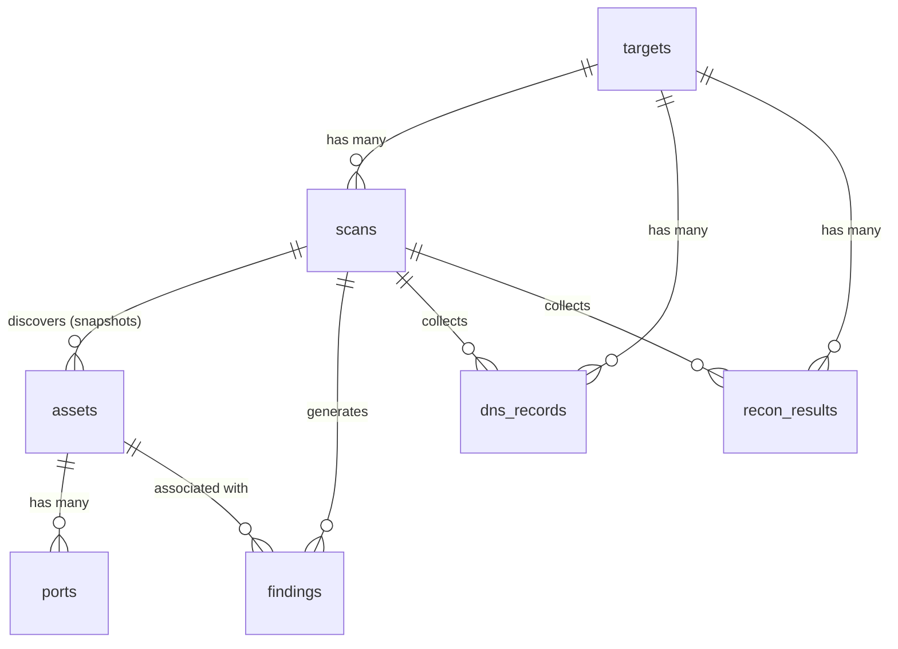

# NetSecureLab — Implementation Plan (v2.1)

> **Source**: Derived from [NetSecureLab.md](file:///c:/Projects/NetSecureLab/NetSecureLab.md)
> **Created**: 2026-10-01
> **Revised**: 2026-10-01 — incorporates architecture review + final corrections
> **Status**: Ready for implementation

---

## Table of Contents

1. [Project Summary](#1-project-summary)
2. [Technology Decisions](#2-technology-decisions)
3. [Architecture Overview](#3-architecture-overview)
4. [Repository Structure](#4-repository-structure)
5. [Database Schema](#5-database-schema)
6. [Phase 1 — Project Scaffolding & Dev Environment](#phase-1--project-scaffolding--dev-environment)
7. [Phase 2 — Data Layer & Core API](#phase-2--data-layer--core-api)
8. [Phase 3 — Scan Orchestrator & Nmap Integration](#phase-3--scan-orchestrator--nmap-integration)
9. [Phase 4 — DNS Intelligence & Passive Reconnaissance](#phase-4--dns-intelligence--passive-reconnaissance)
10. [Phase 5 — Finding Engine, Dashboard & Findings UI](#phase-5--finding-engine-dashboard--findings-ui)
11. [Phase 6 — Scan Comparison & Reporting](#phase-6--scan-comparison--reporting)
12. [Phase 7 — Polish, Testing & Optional Extensions](#phase-7--polish-testing--optional-extensions)
13. [API Reference](#api-reference)
14. [Security Rules Catalog](#security-rules-catalog)
15. [Testing Matrix](#testing-matrix)
16. [Risk Register](#risk-register)
17. [Definition of Done](#definition-of-done)

---

## 1. Project Summary

NetSecureLab is an **integrated network security assessment and reconnaissance framework** for authorized laboratory environments. It is *not* another Nmap GUI or a commercial vulnerability scanner. Its value lies in:

1. Integrating multiple syllabus techniques (passive recon, DNS enumeration, Nmap scanning) into **one pipeline**.
2. Normalizing tool-specific outputs into a **common data model**.
3. Applying **transparent, rule-based security checks** that produce evidence-backed findings.
4. Maintaining **scan history** and enabling **scan-to-scan comparison**.
5. Presenting everything in a **unified web dashboard** and **structured assessment report**.

### Core Workflow

```
Target → Discover → Enumerate → Analyze → Findings → Compare → Report
```

---

## 2. Technology Decisions

| Layer | Technology | Rationale |
|---|---|---|
| **Frontend framework** | React 18+ with Vite | Spec-recommended; fast HMR for development |
| **Frontend styling** | CSS Modules | Scoped styles, no extra dependency, spec-flexible |
| **Frontend routing** | React Router v6 | SPA routing for primary navigation pages |
| **Frontend HTTP client** | Axios | Interceptors for error handling |
| **Frontend charts** | Recharts (minimal use) | Only where charts add analytical value (severity distribution) |
| **Backend framework** | Python 3.11+ / FastAPI | Spec-recommended; auto-generated OpenAPI docs |
| **Backend validation** | Pydantic v2 | Request/response schemas |
| **ORM** | SQLAlchemy 2.0 (sync) | Lightweight ORM over SQLite |
| **Database** | SQLite | Zero-config, file-based, sufficient for lab scale |
| **Nmap execution** | `subprocess.run()` + `xml.etree.ElementTree` | Direct subprocess control with `shell=False`; XML parsed via stdlib. No `python-nmap` dependency needed — we build the command list ourselves and parse the XML ourselves, giving full control over arguments, timeout, return code, and process lifecycle |
| **DNS library** | `dnspython` | Full-featured DNS toolkit, supports all required record types |
| **WHOIS** | `python-whois` (optional enrichment) | Domain metadata for passive recon. Treated as an **optional enrichment source** — the core scan completes successfully if WHOIS is unavailable |
| **Report output** | Jinja2 → HTML | HTML report is the spec minimum; Jinja2 templates are clean |
| **PDF (optional)** | `weasyprint` | Enhancement only — not a core dependency |
| **Scan execution** | `ThreadPoolExecutor(max_workers=1)` | Single-process laboratory job runner. Not a durable job queue — acceptable for lab scope. Explicitly **not** `BackgroundTasks`, Celery, Redis, or RabbitMQ |
| **Testing** | pytest (backend), Vitest (frontend) | Standard test runners for each stack |

### Architectural Rule: Single-Process Execution

**The application is designed for a single Uvicorn worker.** The scan executor is in-process (`ThreadPoolExecutor`), so running multiple application workers (e.g. `uvicorn --workers 4`) would create multiple independent executors, undermining the `max_workers=1` assumption. Always run with:

```bash
uvicorn app.main:app --reload   # development
uvicorn app.main:app             # production (single worker)
```

### Architectural Rule: No `python-nmap`

The plan previously listed `python-nmap` alongside raw XML parsing — that is unnecessary duplication. The implementation uses:

```
subprocess.run([nmap_path, ...args, target], shell=False, timeout=SCAN_TIMEOUT)
    ↓
temporary XML file
    ↓
xml.etree.ElementTree
    ↓
normalized Python dicts
```

This gives complete control over arguments, timeout, return code, stdout/stderr, XML output, and process lifecycle without an extra dependency.

### Architectural Rule: Subprocess Safety

Nmap arguments are constructed as a **list** and executed with `shell=False`. Never construct a shell command string from user input.

```python
# CORRECT
command = [nmap_path, "-sV", "-T4", "-oX", xml_path, target]
subprocess.run(command, shell=False, timeout=SCAN_TIMEOUT)

# NEVER DO THIS
command = f"nmap -sV -T4 {target}"
subprocess.run(command, shell=True)
```

### Architectural Rule: Nmap Profiles Are Backend-Controlled

The frontend sends only a profile name (`quick`, `standard`, `full`). The backend maps profile names to approved argument lists. The API never accepts arbitrary Nmap arguments.

```python
SCAN_PROFILES = {
    "quick": ["-sn"],
    "standard": ["-sV", "-T4", "--top-ports", "1000"],
    "full": ["-sV", "-sC", "-T4", "-p-"],
}
```

### Architectural Rule: OS Detection Procedure

OS detection (`-O`) is **not** embedded in the main `full` command list. Instead, the orchestrator follows this procedure:

```
Full profile execution:
1. Execute the primary scan: -sV -sC -T4 -p- -oX scan.xml
2. Parse and store results (hosts, ports, services)
3. If OS detection is enabled in config:
   a. Execute a separate OS detection pass: -O -oX scan_os.xml
   b. Parse OS results independently
   c. Merge OS strings into the existing asset snapshots (update Asset.os)
   d. If the OS pass fails (insufficient privileges, timeout, etc.):
      - Log "OS detection unavailable — <reason>"
      - Leave Asset.os as null
      - The scan does NOT change to failed status
4. The second pass uses the same SCAN_TIMEOUT
5. The second XML is stored alongside the primary XML
```

This ensures the `full` profile never fails because of OS detection.

---

## 3. Architecture Overview

### Core Pipeline

```
                         React SPA
                            |
                            | REST
                            v
                     FastAPI Application
                            |
              +-------------+-------------+
              |                           |
              v                           v
        API Controllers           Scan Worker Thread
                                  (ThreadPoolExecutor)
                                          |
                                  Scan Orchestrator
                                          |
                    +---------------------+--------------------+
                    |                     |                    |
                    v                     v                    v
                 Nmap                   DNS                 Recon
              (subprocess)          (dnspython)         (whois/optional)
                    |                     |                    |
                    +---------------------+--------------------+
                                          |
                                          v
                                   Normalization
                                          |
                                          v
                                      SQLite
                                          |
                                          v
                                   Finding Engine
                                          |
                         +----------------+----------------+
                         |                                 |
                         v                                 v
                  Dashboard / UI                     Report Engine
                         |
                         v
                  Scan Comparison
```

### Key Architectural Decisions

1. **Nmap, DNS, and Recon are independent collection modules.** DNS failure does not affect Nmap. Nmap failure does not prevent DNS intelligence from being collected. The orchestrator coordinates them, but they do not depend on each other.

2. **The `ScanOrchestrator` owns the workflow.** Individual services (nmap, dns, recon) know their tool. The orchestrator knows the sequence and error handling.

3. **Scans are "assessment runs" with modules selected by target type.** Not every module runs for every target type.

4. **`assets` are scan snapshots.** Each scan creates a new asset record for the same IP. This is intentional — it enables historical comparison. The records represent "host state observed during a specific scan," not a persistent inventory.

5. **Authorization is backend-enforced.** Targets have an `authorization_confirmed` boolean. Scans are rejected unless the target is authorized.

6. **Target normalization is centralized.** A `TargetNormalizer` converts any target input (IP, hostname, domain, URL) into a canonical representation used by all downstream modules. Each module receives the appropriate form (e.g. Nmap gets a scannable host, DNS gets a domain name, DMARC gets `_dmarc.<domain>`).

7. **Module outcomes are tracked.** Each scan records the success/failure/skip status of every collection module (Nmap, DNS, Recon). This prevents "no findings" from being confused with "assessment unavailable."

8. **Cancellation uses a dedicated flag.** `cancel_requested` is a separate boolean from `status`. The orchestrator checks this flag between stages. This cleanly separates "user requested cancellation" from "actual lifecycle state."

### Module Selection by Target Type

```
IP target:
    ✓ Nmap (Network Discovery + Service Enumeration)
    ✗ DNS (not applicable to raw IP)
    ○ Recon (reverse DNS, geolocation — optional)
    ✓ Finding Engine

Domain / Hostname:
    ✓ Nmap (resolve + scan)
    ✓ DNS Intelligence
    ✓ Passive Recon
    ✓ Finding Engine

Web Application:
    ✓ Nmap (extract host, scan)
    ✓ DNS Intelligence (extract hostname)
    ✓ Passive Recon
    ○ ZAP (optional extension)
    ✓ Finding Engine
```

### Scan Lifecycle

```
created
   ↓
queued
   ↓
running
   ↓
   +────→ failed (with error message)
   |
   +────→ cancelled
   |
   ↓
completed
```

The `cancelled` state and `POST /scans/{id}/cancel` endpoint are part of the architecture. Cancellation is **cooperative cancellation between modules** — it does not terminate an already-running Nmap subprocess. The orchestrator checks `cancel_requested` between stages (after Nmap, before DNS, etc.). Killing a running subprocess is a future enhancement.

---

## 4. Repository Structure

```
NetSecureLab/
│
├── frontend/                          # React + Vite SPA
│   ├── public/
│   ├── src/
│   │   ├── assets/                    # Static assets (logo, icons)
│   │   ├── components/                # Reusable UI components
│   │   │   ├── Layout/                # AppShell, Sidebar, Header
│   │   │   ├── Dashboard/             # Metric cards, summary widgets
│   │   │   ├── Targets/               # Target form, target list
│   │   │   ├── Scans/                 # Scan list, scan detail, status badge
│   │   │   │                          #   (tabs: Overview, Hosts, Ports,
│   │   │   │                          #    DNS, Recon, Findings, Compare)
│   │   │   ├── Findings/              # Finding cards, filters, evidence panel
│   │   │   ├── Reports/               # Report viewer, generation controls
│   │   │   └── common/                # Buttons, modals, alerts, badges, loaders
│   │   ├── pages/                     # Route-level page components
│   │   │   ├── DashboardPage.jsx
│   │   │   ├── TargetsPage.jsx
│   │   │   ├── TargetDetailPage.jsx
│   │   │   ├── ScansPage.jsx
│   │   │   ├── ScanDetailPage.jsx     # Tabs: Overview, Hosts, Ports & Services,
│   │   │   │                          #   DNS, Recon, Findings, Compare
│   │   │   ├── FindingsPage.jsx
│   │   │   └── ReportsPage.jsx
│   │   ├── services/                  # API client modules
│   │   │   ├── api.js                 # Axios instance + interceptors
│   │   │   ├── targetService.js
│   │   │   ├── scanService.js
│   │   │   ├── findingService.js
│   │   │   └── reportService.js
│   │   ├── hooks/                     # Custom React hooks
│   │   │   ├── useTargets.js
│   │   │   ├── useScans.js
│   │   │   ├── useScanPolling.js
│   │   │   └── useDashboardStats.js
│   │   ├── utils/                     # Formatters, constants, helpers
│   │   ├── App.jsx                    # Root component + router
│   │   ├── App.module.css
│   │   ├── main.jsx                   # Entry point
│   │   └── index.css                  # Global styles / design tokens
│   ├── index.html
│   ├── vite.config.js
│   └── package.json
│
├── backend/                           # Python / FastAPI
│   ├── app/
│   │   ├── __init__.py
│   │   ├── main.py                    # FastAPI app entry, CORS, lifespan
│   │   ├── config.py                  # Settings, scan profiles, timeouts
│   │   ├── database/
│   │   │   ├── __init__.py
│   │   │   ├── connection.py          # Engine, SessionLocal, Base
│   │   │   └── init_db.py            # Table creation on startup
│   │   ├── models/                    # SQLAlchemy ORM models
│   │   │   ├── __init__.py
│   │   │   ├── target.py
│   │   │   ├── scan.py
│   │   │   ├── asset.py
│   │   │   ├── port.py
│   │   │   ├── dns_record.py
│   │   │   ├── recon_result.py
│   │   │   └── finding.py
│   │   ├── schemas/                   # Pydantic request/response schemas
│   │   │   ├── __init__.py
│   │   │   ├── target.py
│   │   │   ├── scan.py
│   │   │   ├── asset.py
│   │   │   ├── port.py
│   │   │   ├── dns_record.py
│   │   │   ├── recon_result.py
│   │   │   ├── finding.py
│   │   │   └── comparison.py
│   │   ├── api/                       # API route handlers
│   │   │   ├── __init__.py
│   │   │   ├── targets.py
│   │   │   ├── scans.py
│   │   │   ├── results.py
│   │   │   ├── findings.py
│   │   │   ├── comparison.py
│   │   │   ├── reports.py
│   │   │   └── dashboard.py
│   │   ├── services/                  # Business logic & tool adapters
│   │   │   ├── __init__.py
│   │   │   ├── scan_orchestrator.py   # Coordinates the full scan workflow
│   │   │   ├── nmap/
│   │   │   │   ├── __init__.py
│   │   │   │   ├── executor.py        # Build command list, subprocess.run
│   │   │   │   ├── parser.py          # xml.etree.ElementTree parsing
│   │   │   │   └── normalizer.py      # Parsed dicts → ORM records
│   │   │   ├── dns/
│   │   │   │   ├── __init__.py
│   │   │   │   └── service.py         # dnspython lookups (A, MX, TXT, etc.)
│   │   │   ├── recon/
│   │   │   │   ├── __init__.py
│   │   │   │   └── service.py         # WHOIS + optional enrichment
│   │   │   ├── findings/
│   │   │   │   ├── __init__.py
│   │   │   │   ├── engine.py          # Iterate rules, generate findings
│   │   │   │   └── rules.py           # Rule registry + rule functions
│   │   │   ├── comparison/
│   │   │   │   ├── __init__.py
│   │   │   │   └── service.py         # Scan diff engine
│   │   │   └── reporting/
│   │   │       ├── __init__.py
│   │   │       └── service.py         # Jinja2 HTML report generation
│   │   ├── workers/
│   │   │   ├── __init__.py
│   │   │   └── scan_worker.py         # ThreadPoolExecutor(max_workers=1)
│   │   ├── templates/                 # Jinja2 report templates
│   │   │   └── report.html
│   │   └── utils/
│   │       ├── __init__.py
│   │       ├── target_normalizer.py   # URL/hostname/domain → canonical forms
│   │       ├── validators.py          # Target input validation
│   │       └── logger.py              # Structured logging setup
│   ├── tests/
│   │   ├── fixtures/                  # Sample Nmap XML files
│   │   │   └── sample_scan.xml
│   │   ├── test_targets.py
│   │   ├── test_scans.py
│   │   ├── test_nmap_parser.py
│   │   ├── test_dns_service.py
│   │   ├── test_finding_engine.py
│   │   ├── test_orchestrator.py       # Orchestrator workflow tests
│   │   ├── test_comparison.py
│   │   └── test_report.py
│   ├── requirements.txt
│   └── pyproject.toml
│
├── reports/                           # Generated report output directory
├── scans/                             # Raw Nmap XML output directory
├── docs/                              # Project documentation
├── NetSecureLab.md                    # Project specification (source of truth)
├── plan.md                            # This file
└── README.md
```

### Structural Differences from v1

| Change | Rationale |
|---|---|
| `routes/` → `api/` | Clearer separation of API layer from business logic |
| Added `services/scan_orchestrator.py` | Owns the scan workflow — the biggest missing component in v1 |
| Added `workers/scan_worker.py` | Explicit scan executor using `ThreadPoolExecutor` instead of `BackgroundTasks` |
| `nmap_service.py` → `nmap/executor.py`, `nmap/parser.py`, `nmap/normalizer.py` | Clean separation of Nmap concerns |
| Services split into subdirectories | Each tool adapter is isolated: `nmap/`, `dns/`, `recon/`, `findings/`, `comparison/`, `reporting/` |
| Added `utils/target_normalizer.py` | Centralized URL/hostname/domain → canonical forms for all downstream modules |
| Frontend pages consolidated | DNS, Assets, Comparison are tabs within ScanDetailPage — not separate route-level pages |
| Fewer API service modules in frontend | Matches the reduced page count |

### Frontend Navigation (Primary Sidebar)

```
Dashboard
Targets
Scans
Findings
Reports
```

DNS Intelligence, Assets, Recon, and Comparison are **contextual views** — tabs within the Scan Detail page:

```
Scan Detail
├── Overview (status, profile, duration, target)
├── Hosts (discovered assets)
├── Ports & Services
├── DNS (if domain/hostname target)
├── Recon (if applicable)
├── Findings (scan-specific findings)
└── Compare (select another scan to diff)
```

---

## 5. Database Schema

All tables use SQLite. Relationships are enforced via foreign keys.

**SQLite foreign-key enforcement must be explicitly enabled** on every database connection via `PRAGMA foreign_keys = ON`. SQLAlchemy does not enable this by default for SQLite. The `connection.py` module must include an event listener:

```python
from sqlalchemy import event

@event.listens_for(engine, "connect")
def set_sqlite_pragma(dbapi_connection, connection_record):
    cursor = dbapi_connection.cursor()
    cursor.execute("PRAGMA foreign_keys=ON")
    cursor.close()
```

### 5.1 `targets`

| Column | Type | Constraints | Notes |
|---|---|---|---|
| `id` | INTEGER | PK, AUTOINCREMENT | |
| `name` | TEXT | NOT NULL | Human-readable label |
| `target` | TEXT | NOT NULL | IP, hostname, domain, or URL |
| `target_type` | TEXT | NOT NULL | Enum: `ip`, `hostname`, `domain`, `web_application` |
| `description` | TEXT | | Optional context |
| `authorization_confirmed` | BOOLEAN | NOT NULL, DEFAULT FALSE | **Backend-enforced.** Scans are rejected unless this is `true`. Makes authorization a technical control, not just a UI warning |
| `created_at` | DATETIME | NOT NULL, DEFAULT NOW | |

### 5.2 `scans`

| Column | Type | Constraints | Notes |
|---|---|---|---|
| `id` | INTEGER | PK, AUTOINCREMENT | |
| `target_id` | INTEGER | FK → targets.id, NOT NULL | |
| `profile` | TEXT | NOT NULL | Enum: `quick`, `standard`, `full` |
| `status` | TEXT | NOT NULL, DEFAULT `created` | Enum: `created`, `queued`, `running`, `completed`, `failed`, `cancelled` |
| `cancel_requested` | BOOLEAN | NOT NULL, DEFAULT FALSE | **Separate from status.** `POST /scans/{id}/cancel` sets this to `true`. The orchestrator checks this flag between stages and transitions status to `cancelled`. Distinguishes "user requested cancellation" from "actual lifecycle state" |
| `started_at` | DATETIME | | |
| `completed_at` | DATETIME | | |
| `duration` | REAL | | Seconds |
| `nmap_status` | TEXT | DEFAULT `pending` | Enum: `pending`, `success`, `failed`, `skipped`. Tracks whether the Nmap collection module succeeded, failed, or was skipped |
| `dns_status` | TEXT | DEFAULT `pending` | Enum: `pending`, `success`, `partial`, `failed`, `skipped`. `partial` = some record types failed |
| `recon_status` | TEXT | DEFAULT `pending` | Enum: `pending`, `success`, `partial`, `failed`, `skipped`. `partial` = some sources failed (e.g. WHOIS down) |
| `raw_output_path` | TEXT | | Internal path to Nmap XML — **never exposed through the API**. API exposes `raw_output_available: bool` and `GET /scans/{id}/raw`. Path is always generated as `SCANS_DIR / f"{scan_id}.xml"` — never stored from external input. The backend validates resolved paths remain under `SCANS_DIR` before serving |
| `error_message` | TEXT | | Populated on failure or timeout |

Module outcome columns (`nmap_status`, `dns_status`, `recon_status`) allow the report and dashboard to distinguish:
- "No FTP found" (Nmap succeeded, no FTP port detected)
- "FTP assessment unavailable" (Nmap failed, service exposure could not be assessed)

### 5.3 `assets` (scan snapshots)

Each scan creates new asset records. These represent **host state observed during a specific scan**, not a persistent asset inventory. This is intentional — it enables historical comparison by preserving snapshots.

| Column | Type | Constraints | Notes |
|---|---|---|---|
| `id` | INTEGER | PK, AUTOINCREMENT | |
| `scan_id` | INTEGER | FK → scans.id, NOT NULL | |
| `ip` | TEXT | NOT NULL | |
| `hostname` | TEXT | | |
| `status` | TEXT | | `up`, `down` |
| `os` | TEXT | | Best-guess OS string, or `null` if detection unavailable |
| `discovered_at` | DATETIME | NOT NULL | |

Constraint: `UNIQUE(scan_id, ip)` — prevents duplicate asset records within a single scan.

### 5.4 `ports`

| Column | Type | Constraints | Notes |
|---|---|---|---|
| `id` | INTEGER | PK, AUTOINCREMENT | |
| `asset_id` | INTEGER | FK → assets.id, NOT NULL | |
| `port_number` | INTEGER | NOT NULL | |
| `protocol` | TEXT | NOT NULL | `tcp`, `udp` |
| `state` | TEXT | NOT NULL | `open`, `closed`, `filtered` |
| `service` | TEXT | | Service name |
| `product` | TEXT | | Product name |
| `version` | TEXT | | Version string |
| `extra_info` | TEXT | | |

Constraint: `UNIQUE(asset_id, port_number, protocol)` — prevents duplicate port records within a single asset snapshot.

### 5.5 `dns_records`

| Column | Type | Constraints | Notes |
|---|---|---|---|
| `id` | INTEGER | PK, AUTOINCREMENT | |
| `target_id` | INTEGER | FK → targets.id, NOT NULL | |
| `scan_id` | INTEGER | FK → scans.id | Nullable — can be target-level |
| `record_type` | TEXT | NOT NULL | `A`, `AAAA`, `NS`, `MX`, `TXT`, `CNAME`, `SOA`, `PTR` |
| `name` | TEXT | NOT NULL | Queried name (e.g. `example.com`, `_dmarc.example.com`) |
| `value` | TEXT | NOT NULL | Resolved value |
| `ttl` | INTEGER | | Seconds |
| `collected_at` | DATETIME | NOT NULL | |

Constraint: `UNIQUE(scan_id, record_type, name, value)` — prevents duplicate records within a single scan.

### 5.6 `recon_results`

| Column | Type | Constraints | Notes |
|---|---|---|---|
| `id` | INTEGER | PK, AUTOINCREMENT | |
| `target_id` | INTEGER | FK → targets.id, NOT NULL | |
| `scan_id` | INTEGER | FK → scans.id | |
| `category` | TEXT | NOT NULL | e.g. `domain_info`, `registrar`, `nameserver`, `geolocation` |
| `key` | TEXT | NOT NULL | e.g. `registrar`, `creation_date` |
| `value` | TEXT | NOT NULL | |
| `source` | TEXT | NOT NULL | e.g. `whois`, `dns`, `ip_api` |
| `collected_at` | DATETIME | NOT NULL | |

Constraint: `UNIQUE(scan_id, category, key, value, source)` — prevents duplicate enrichment records within a single scan.

### 5.7 `findings`

| Column | Type | Constraints | Notes |
|---|---|---|---|
| `id` | INTEGER | PK, AUTOINCREMENT | |
| `scan_id` | INTEGER | FK → scans.id, NOT NULL | |
| `asset_id` | INTEGER | FK → assets.id | Nullable for non-asset findings (e.g. DNS) |
| `rule_id` | TEXT | NOT NULL | e.g. `R001`. **Traces every finding back to its rule.** Essential for comparison, debugging, and viva explanation |
| `category` | TEXT | NOT NULL | e.g. `service_exposure`, `fingerprinting`, `dns_security` |
| `title` | TEXT | NOT NULL | Human-readable title |
| `description` | TEXT | NOT NULL | What was found and why it matters |
| `severity` | TEXT | NOT NULL | Enum: `high`, `medium`, `low`, `informational` |
| `evidence` | TEXT | NOT NULL | Raw evidence supporting the finding |
| `source` | TEXT | NOT NULL | `nmap`, `dns`, `recon`, `zap` |
| `recommendation` | TEXT | NOT NULL | What the administrator should review |
| `created_at` | DATETIME | NOT NULL | |

### ER Diagram



---

## Phase 1 — Project Scaffolding & Dev Environment

**Goal**: Both the frontend and backend run locally with a connected SQLite database and CORS-enabled communication. No features yet — just the wiring.

### Tasks

| # | Task | Details | Deliverable |
|---|---|---|---|
| 1.1 | **Initialize backend** | Create `backend/` dir, `pyproject.toml`, `requirements.txt` with: `fastapi`, `uvicorn[standard]`, `sqlalchemy`, `pydantic`, `dnspython`, `python-whois`, `jinja2`, `pytest`. No `python-nmap`. | Working `uvicorn` dev server on `localhost:8000` |
| 1.2 | **FastAPI app skeleton** | Create `app/main.py` with lifespan handler (init DB + start scan worker + recover stale scans on startup, shutdown worker on exit), CORS middleware (allow `localhost:5173`), health-check endpoint `GET /health`. | `GET /health` returns `{"status": "ok"}` |
| 1.3 | **Database connection** | Create `database/connection.py` — SQLAlchemy engine pointing to `netsecurelab.db`, `SessionLocal`, `Base`. **Enable SQLite foreign keys** via `PRAGMA foreign_keys=ON` event listener on every connection. Create `database/init_db.py` — called on app startup to create all tables. | DB file auto-created on first run, FK enforcement active |
| 1.4 | **Config module** | `app/config.py` — `Settings` class with `DB_URL`, `SCANS_DIR`, `REPORTS_DIR`, `NMAP_PATH`, `SCAN_TIMEOUT` (default 600s), `SCAN_PROFILES` dict, `OS_DETECTION_ENABLED` (default true). Loaded from env vars with sensible defaults. | Centralized configuration |
| 1.5 | **Scan worker stub** | `workers/scan_worker.py` — `ScanWorker` class wrapping `ThreadPoolExecutor(max_workers=1)`. Methods: `submit(scan_id)`, `shutdown()`. No actual scan logic yet — just the infrastructure. | Scan execution infrastructure |
| 1.6 | **Stale scan recovery** | On application startup, find all scans with `status` = `queued` or `running` and mark them as `failed` with `error_message` = "Scan interrupted — application was restarted." This prevents scans from being permanently stuck in a non-terminal state after a crash or restart. | Stale scan cleanup |
| 1.7 | **Logger setup** | `app/utils/logger.py` — structured logging with timestamp, module, level. | Consistent log format across all services |
| 1.8 | **Initialize frontend** | `npx -y create-vite@latest ./frontend -- --template react`, install deps: `react-router-dom`, `axios`. | Vite dev server on `localhost:5173` |
| 1.9 | **Global styles & design tokens** | Create `frontend/src/index.css` — CSS custom properties for color palette (dark theme), typography (Inter from Google Fonts), spacing scale, border-radius, shadow levels, severity colors. | Design system ready |
| 1.10 | **App shell & routing** | `App.jsx` — sidebar navigation with 5 primary links (Dashboard, Targets, Scans, Findings, Reports), `<Outlet>` for page content. Placeholder pages for all routes. | Clickable navigation, all routes render |
| 1.11 | **API client** | `services/api.js` — Axios instance with `baseURL: http://localhost:8000`, response interceptor for error toasts. | Frontend can call backend |
| 1.12 | **Verify integration** | Frontend calls `GET /health` and shows status on Dashboard placeholder. | End-to-end connectivity confirmed |

### Exit Criteria
- `npm run dev` serves the frontend with a working sidebar and placeholder pages.
- `uvicorn app.main:app --reload` serves the backend with `/health`.
- `ScanWorker` starts and shuts down cleanly with the app lifecycle.
- Stale `running`/`queued` scans from a previous crash are marked `failed` on startup.
- SQLite foreign keys are enforced.
- Frontend successfully calls backend and displays the health status.

---

## Phase 2 — Data Layer & Core API

**Goal**: Full CRUD for Targets and Scans. All ORM models defined. Frontend can create targets and initiate scans (scan execution is stubbed). Authorization is backend-enforced.

### Tasks

| # | Task | Details | Deliverable |
|---|---|---|---|
| 2.1 | **ORM models** | Create all 7 SQLAlchemy models (`Target`, `Scan`, `Asset`, `Port`, `DNSRecord`, `ReconResult`, `Finding`) with relationships and uniqueness constraints. `Asset` includes `UNIQUE(scan_id, ip)`. `Port` includes `UNIQUE(asset_id, port_number, protocol)`. `DNSRecord` includes `UNIQUE(scan_id, record_type, name, value)`. `ReconResult` includes `UNIQUE(scan_id, category, key, value, source)`. `Finding` includes `rule_id` column. `Scan` includes `cancel_requested`, `nmap_status`, `dns_status`, `recon_status` columns. | Models importable, tables auto-created |
| 2.2 | **Pydantic schemas** | Request/response schemas for all entities. `TargetCreate` includes `authorization_confirmed` boolean. `ScanCreate` contains only `target_id` + `profile` (enum). `ScanResponse` exposes `raw_output_available: bool` instead of `raw_output_path`, and includes module outcome fields (`nmap_status`, `dns_status`, `recon_status`). | Validation + serialization layer |
| 2.3 | **Target routes** | `POST /targets` (create), `GET /targets` (list), `GET /targets/{id}` (detail), `DELETE /targets/{id}` — **deletion is restricted**: returns HTTP 409 if the target has any associated scans. Targets with scan history cannot be deleted to preserve historical comparison integrity. | Full target CRUD with deletion restriction |
| 2.4 | **Target input validation** | `utils/validators.py` — validate IP addresses, hostnames, domains, and URLs. Reject malformed input with clear error messages. No shell metacharacters. | Security-safe target validation |
| 2.5 | **Target normalizer** | `utils/target_normalizer.py` — converts any target input into canonical forms for downstream modules. For example: `https://example.com/login` → `{original: "https://example.com/login", hostname: "example.com", scan_target: "example.com", dns_name: "example.com", scheme: "https", port: null}`. All modules use the normalizer output instead of parsing the target independently. | Centralized target normalization |
| 2.6 | **Scan routes (stub)** | `POST /scans` — creates scan record with status `created`, **rejects if `authorization_confirmed` is false** on the target (HTTP 403), submits to scan worker (which is still a no-op stub). `GET /scans`, `GET /scans/{id}`, `GET /scans/{id}/status`, `POST /scans/{id}/cancel` (sets `cancel_requested = true`). | Scan lifecycle API with authorization enforcement |
| 2.7 | **Targets page (frontend)** | Target list table, "Add Target" modal/form with fields (name, target, type, description, authorization checkbox). Authorization notice banner. Checkbox label: "I confirm I have explicit authorization to assess this target." Delete button disabled/hidden for targets with scans. | Functional target management UI |
| 2.8 | **Target detail page** | Shows target info + authorization status, list of scans for this target, "New Scan" button with profile selector (Quick / Standard / Full). Button disabled if not authorized. | Target-to-scan workflow |
| 2.9 | **Scans page** | Table of all scans with columns: target, profile, status (badge), started_at, duration, finding count. Click row → scan detail. | Scan overview |
| 2.10 | **Scan detail page (stub)** | Shows scan metadata + module outcome indicators (Nmap/DNS/Recon status). Tab structure: Overview, Hosts, Ports & Services, DNS, Recon, Findings, Compare. All tabs show "No results yet" placeholder. | Scan detail structure ready for Phase 3 |

### Exit Criteria
- Can create a target with authorization confirmation, see it listed, view its detail page.
- Can start a scan from the target detail page (only if authorized), see it in the scans list.
- `POST /scans` rejects unauthorized targets with HTTP 403.
- API validation rejects invalid targets with informative errors.
- All data persists in SQLite.

---

## Phase 3 — Scan Orchestrator & Nmap Integration

**Goal**: The scan orchestrator coordinates scan execution. Nmap runs via subprocess, produces XML, which is parsed and normalized into host/port/service snapshots. The scan detail page shows real results.

### Tasks

| # | Task | Details | Deliverable |
|---|---|---|---|
| 3.1 | **Scan orchestrator** | `services/scan_orchestrator.py` — `run_scan(scan_id, db_session_factory)`: the central coordination function. Uses `TargetNormalizer` to derive `scan_target`, `dns_name`, etc. Updates status to `running`. Checks `cancel_requested` between stages. Calls Nmap, then (in Phase 4) DNS and Recon, then (in Phase 5) Finding Engine. Updates individual module outcome columns (`nmap_status`, `dns_status`, `recon_status`). Updates status to `completed` or `failed`. Catches all exceptions, logs them, sets error message. | Central scan workflow coordinator |
| 3.2 | **Wire scan worker** | `workers/scan_worker.py` — `submit(scan_id)` now calls `scan_orchestrator.run_scan()` inside the thread pool. The worker creates its own DB session (not shared across threads). | Threaded scan execution |
| 3.3 | **Nmap executor** | `services/nmap/executor.py` — `execute(scan_target, profile, output_path)`: accepts the normalized `scan_target` (not the raw user input). Builds command list from `SCAN_PROFILES[profile]`, appends `-oX output_path` and `scan_target`. Output path is always `SCANS_DIR / f"{scan_id}.xml"`. Executes with `subprocess.run(command, shell=False, timeout=SCAN_TIMEOUT, capture_output=True)`. Returns exit code, stdout, stderr. Handles `subprocess.TimeoutExpired` (→ `nmap_status=failed`, "Scan timed out"), `FileNotFoundError` (→ "Nmap not installed"), non-zero exit codes. | Safe Nmap execution with timeout |
| 3.4 | **Nmap parser** | `services/nmap/parser.py` — `parse_xml(xml_path)`: uses `xml.etree.ElementTree` to parse Nmap XML output. Returns structured dicts: hosts (IP, hostname, status, OS or `null`), ports (number, protocol, state, service, product, version, extra_info), script results. | Structured parse output |
| 3.5 | **Nmap normalizer** | `services/nmap/normalizer.py` — `normalize_and_store(scan_id, parsed_data, db_session)`: creates `Asset` and `Port` ORM records from parsed data, respecting uniqueness constraints. Commits to DB. | Normalized snapshots in database |
| 3.6 | **OS detection handling** | For the `full` profile, OS detection follows the procedure defined in §2: separate `-O` pass, independent parsing, merge into asset snapshots, non-fatal failure. The orchestrator updates `Asset.os` for matching assets. The OS pass uses the same `SCAN_TIMEOUT`. Can be disabled via `OS_DETECTION_ENABLED` config. | Graceful OS detection fallback |
| 3.7 | **Result routes** | `GET /scans/{id}/hosts` → list of asset snapshots. `GET /scans/{id}/ports` → list of ports. `GET /scans/{id}/services` → distinct services with counts. `GET /scans/{id}/raw` → serves the raw XML file. Backend resolves the path as `SCANS_DIR / f"{scan_id}.xml"` and validates the resolved path remains under `SCANS_DIR` before serving (prevents path traversal). | Result query + raw download endpoints |
| 3.8 | **Scan status polling (frontend)** | `useScanPolling` hook: polls `GET /scans/{id}/status` every 3s while status is `queued` or `running`. Stops on `completed`, `failed`, or `cancelled`. | Live scan status in UI |
| 3.9 | **Scan detail — results tabs** | **Overview tab**: includes module outcome indicators showing Nmap/DNS/Recon status (success/failed/skipped). **Hosts tab**: table of discovered hosts (IP, hostname, status, OS). **Ports & Services tab**: table of all ports grouped by host. Shows "Nmap collection failed" banner if `nmap_status=failed`. | Results visible after scan completes |
| 3.10 | **Error handling** | Handle: Nmap not installed (`FileNotFoundError`), target unreachable (Nmap exit code), permission denied (stderr parsing), timeout (`TimeoutExpired`), invalid XML. Display user-friendly error in scan detail via `error_message`. Log full error in backend. Never expose raw exception traces in the API. | Graceful failure handling |
| 3.11 | **Cancel implementation** | `POST /scans/{id}/cancel` — sets `cancel_requested = true` in DB. The orchestrator checks `cancel_requested` between stages (after Nmap, before DNS, etc.). If true, status → `cancelled`. This is cooperative cancellation — it does not terminate an already-running Nmap subprocess. | Cancellation support |

### Scan Profiles (Final)

```
Quick
  -sn (host discovery only)

Standard
  -sV -T4 --top-ports 1000
  (TCP port discovery + service detection, top 1000 ports)

Full
  Primary: -sV -sC -T4 -p-
  (full TCP range + service detection + default scripts)
  OS pass: -O (separate execution, see OS Detection Procedure in §2)
```

OS detection is handled via the OS Detection Procedure defined in §2 — separate execution, independent parsing, merged results, non-fatal failure.

### Exit Criteria
- Creating a scan against a reachable target runs Nmap via subprocess, parses XML, and stores host/port/service snapshots.
- Scan detail page shows discovered hosts, open ports, and services after completion.
- Failed scans (Nmap missing, timeout, unreachable) show a clear error message — no crashes.
- Raw XML is saved to `scans/` and downloadable via `GET /scans/{id}/raw`.
- Cancellation sets status to `cancelled`.

---

## Phase 4 — DNS Intelligence & Passive Reconnaissance

**Goal**: DNS and recon modules are wired into the scan orchestrator as **independent collection modules**. They run regardless of Nmap success/failure (for applicable target types). Results are displayed in the scan detail tabs.

### Tasks

| # | Task | Details | Deliverable |
|---|---|---|---|
| 4.1 | **DNS service** | `services/dns/service.py` — `collect(dns_name)`: accepts the normalized `dns_name` from `TargetNormalizer`. Uses `dnspython` to query records. Handles each record type independently — one failure doesn't abort the others. Returns list of normalized dicts and a status (`success`, `partial`, `failed`). | DNS record collection |
| 4.2 | **DNS record types** | Queried for `target_type=domain` only (not arbitrary hostnames). Mandatory: A, AAAA, NS, MX, TXT (for `<domain>`). Additional: `_dmarc.<domain>` TXT lookup (for DMARC). Optional: CNAME, SOA, PTR. The DNS service explicitly queries `_dmarc.<domain>` as a separate lookup — not just the root-domain TXT records. For `hostname` targets, DNS resolution is performed but domain-level policy checks (SPF/DMARC) are skipped unless the parent domain can be reliably derived. | Correct DMARC architecture + domain-level scoping |
| 4.3 | **DNS storage** | `dns/service.py` — `store_results(target_id, scan_id, records, db_session)`: persists DNS records to the `dns_records` table, respecting uniqueness constraints. | DNS data persisted |
| 4.4 | **Recon service** | `services/recon/service.py` — `collect(normalized_target)`: accepts `TargetNormalizer` output. WHOIS is an **optional enrichment source** — the entire function is wrapped in try/except. If `python-whois` fails or the library is not installed, the scan continues (`recon_status=partial`). Other sources: resolved IP addresses, reverse DNS (for IP targets). Each source is independently try/excepted. Returns results and a status. | Passive recon collection (graceful) |
| 4.5 | **Recon storage** | `recon/service.py` — `store_results(target_id, scan_id, results, db_session)`: persists recon results as key-value pairs, respecting uniqueness constraint `UNIQUE(scan_id, category, key, value, source)`. | Recon data persisted |
| 4.6 | **Wire into orchestrator** | The orchestrator uses `TargetNormalizer` output to determine which modules run. For `domain` → Nmap + DNS + Recon. For `hostname` → Nmap + DNS (resolution only, no domain-level policy checks) + Recon. For `ip` → Nmap + Recon (optional). For `web_application` → extract hostname via normalizer, then Nmap + DNS + Recon. Each module updates its outcome column (`nmap_status`, `dns_status`, `recon_status`). **DNS failure does not affect Nmap. Nmap failure does not prevent DNS.** Each module's failure is logged and the orchestrator continues. | Independent module execution with outcome tracking |
| 4.7 | **DNS tab in scan detail** | Scan detail "DNS" tab: record type sections (A/AAAA, NS, MX, TXT, DMARC, Other), tabular display with TTL. Shows "DNS not applicable" for IP-only targets. Shows `dns_status` indicator. | DNS intelligence UI |
| 4.8 | **Recon tab in scan detail** | Scan detail "Recon" tab: key-value pairs grouped by category (Domain Info, Registration, Infrastructure). Shows "Recon data unavailable" if WHOIS failed. Shows `recon_status` indicator. | Recon results visible |

### Exit Criteria
- Scanning a domain target collects DNS records (including `_dmarc.<domain>`) and passive recon data.
- Scanning an IP target skips DNS, attempts recon, and completes regardless.
- If WHOIS is unavailable, the scan still completes successfully with an informational note.
- If DNS fails for one record type, the others are still collected.
- Nmap failure does not prevent DNS/Recon collection.

---

## Phase 5 — Finding Engine, Dashboard & Findings UI

**Goal**: The rule-based finding engine runs after every scan, generating evidence-backed findings with correct severity semantics. The dashboard shows aggregated metrics. The findings page allows filtering and review.

### Tasks

| # | Task | Details | Deliverable |
|---|---|---|---|
| 5.1 | **Security rules registry** | `services/findings/rules.py` — define a `Rule` dataclass: `id`, `name`, `description`, `severity`, `category`, `check_function`, `applicable_modules` (list of required module statuses). Create a `RULES` list. Each rule is a pure function: `(scan_data) → list[FindingDict]`. Every generated finding includes the `rule_id`. | Extensible, traceable rule system |
| 5.2 | **Implement core rules** | See [Security Rules Catalog](#security-rules-catalog) below. 12 rules with corrected severity semantics. Findings describe **observed facts** and **recommend review** — they do not claim to identify vulnerabilities. SPF/DMARC rules (R010, R011) apply only to `target_type=domain`. | Evidence-backed rule coverage |
| 5.3 | **Finding engine** | `services/findings/engine.py` — `run(scan_id, db_session)`: loads all normalized data for the scan (assets, ports, DNS records, recon results) and module outcome statuses. Skips rules whose required modules failed (e.g. skips port-based rules if `nmap_status=failed`). Iterates applicable rules, collects generated findings (each with `rule_id`), stores them in `findings` table. | Automated finding generation with module-awareness |
| 5.4 | **Wire into orchestrator** | After all collection modules complete and data is stored, the orchestrator runs the finding engine. Status is set to `completed` only after findings are generated. The finding engine uses module outcome statuses to avoid generating misleading "no findings" when a module actually failed. | Findings auto-generated on scan completion |
| 5.5 | **Findings routes** | `GET /scans/{id}/findings` — findings for a scan (filterable by severity, category, source). `GET /findings` — all findings across scans (with filters). | Findings query API |
| 5.6 | **Dashboard API** | `GET /dashboard/stats` — returns: total targets, total hosts discovered, total open ports, total services identified, total findings, findings by severity, recent scans (last 5). | Dashboard metrics endpoint |
| 5.7 | **Dashboard page (frontend)** | Metric cards row: Targets, Hosts, Open Ports, Services, Findings. Severity summary (colored bars). Recent scans table: target, status badge, finding count, date. | Information-dense dashboard |
| 5.8 | **Findings page (frontend)** | Findings table with columns: severity (colored badge), title, asset, category, source, rule ID. Filter bar: severity, category, source. Click finding → expandable detail showing description, evidence, recommendation, and rule ID. | Findings review UI |
| 5.9 | **Scan detail — findings tab** | Findings tab in scan detail page shows findings specific to that scan, with the same format as the main findings page. | Scan-specific findings |

### Exit Criteria
- Every completed scan generates findings automatically with `rule_id` traceability.
- Findings describe observed facts, not claimed vulnerabilities.
- Dashboard shows accurate aggregate metrics.
- Findings page allows filtering by severity/category/source.
- Each finding shows clear evidence, recommendation, and rule ID.

---

## Security Rules Catalog

### Severity Semantics

Findings represent **observed facts assessed against project-defined security policies**. They do not claim to identify vulnerabilities. The report must distinguish:
- **Observed fact**: "TCP/3306 is reachable and identified as MySQL"
- **Project rule**: "Direct exposure of database services is classified as requiring review"
- **Recommendation**: "Verify whether MySQL should be directly reachable"

| Rule ID | Title | Condition | Severity | Category | Notes |
|---|---|---|---|---|---|
| `R001` | FTP Service Reachable | TCP/21 open | Medium | Service Exposure | FTP is unencrypted; warrants review, not automatically "High" |
| `R002` | Telnet Service Reachable | TCP/23 open | Medium | Service Exposure | Telnet transmits in cleartext |
| `R003` | Database Service Reachable | TCP 3306/5432/1433/1521/27017 open | Medium | Service Exposure | Reachability ≠ vulnerability. Recommends review of network exposure |
| `R004` | SMB/NetBIOS Service Reachable | TCP 139/445 open | Medium | Service Exposure | File sharing services exposed |
| `R005` | RDP Service Reachable | TCP/3389 open | Low | Service Exposure | Remote desktop accessible |
| `R006` | Web Service Detected | TCP 80/443/8080/8443 with HTTP | Informational | Web Discovery | Records web application for further assessment |
| `R007` | SSH Service Detected | TCP/22 open | Informational | Service Info | SSH detected; informational only. Requires `nmap_status=success` |
| `R008` | Service Version Identified | Service version string detected by Nmap | Informational | Fingerprinting | Records version for inventory. Does NOT claim the version is vulnerable. Requires `nmap_status=success` |
| `R009` | OS Fingerprint Identified | OS detection returned results | Informational | Fingerprinting | Records OS for inventory. Requires `nmap_status=success` |
| `R010` | SPF Record Not Found | No TXT record containing `v=spf1` for domain | Low | DNS Security | **Domain-level rule only** — applies exclusively to `target_type=domain`. Queried from root domain TXT records. Requires `dns_status=success` |
| `R011` | DMARC Record Not Found | No TXT record at `_dmarc.<domain>` | Low | DNS Security | **Domain-level rule only** — applies exclusively to `target_type=domain`. Queried from `_dmarc.<domain>` — not root domain TXT. Requires `dns_status=success` |
| `R012` | Multiple MX Servers | More than one MX record | Informational | Mail Infrastructure | **Domain-level rule only.** Informational mail infrastructure note. Requires `dns_status=success` |

### Removed from v1
- **R013 ("Unfiltered High Port Service")**: Removed. Port number alone is not a security indicator — a legitimate application can run on any port. This rule risked generating findings that look authoritative but aren't supported by evidence.

### Severity Rationale

| Severity | Meaning in this project |
|---|---|
| **Medium** | Service exposure that warrants administrator review per project policy |
| **Low** | Configuration observation worth noting but not urgent |
| **Informational** | Observed fact recorded for inventory and reporting |

The project does **not** use "High" severity for port-open findings because reachability alone does not establish a vulnerability. If the project later adds version-to-CVE correlation, those findings could be assigned "High" with proper evidence.

---

## Phase 6 — Scan Comparison & Reporting

**Goal**: Users can compare two scans of the same target to detect changes in normalized snapshots. Users can generate a structured HTML assessment report.

### Tasks

| # | Task | Details | Deliverable |
|---|---|---|---|
| 6.1 | **Comparison engine** | `services/comparison/service.py` — `compare(scan_id_1, scan_id_2, db_session)`: compares **normalized snapshots** (not raw DB rows). Returns structured diff: new/removed hosts, new/removed ports, new/removed services, service version changes, new/resolved findings (compared by `rule_id` + asset). Validates both scans belong to the same target. | Scan diff engine |
| 6.2 | **Comparison route** | `GET /scans/compare/{scan1_id}/{scan2_id}` — returns the structured comparison result. | Comparison API |
| 6.3 | **Compare tab in scan detail** | "Compare" tab in scan detail: dropdown to select another scan of the same target. Diff display grouped by category (Hosts, Ports, Services, Findings) with `+` added / `-` removed / `~` changed indicators, color-coded. | Visual scan comparison |
| 6.4 | **Report template** | `templates/report.html` — Jinja2 template. Sections: assessment overview, target info, scan info, **module outcome summary** (which modules succeeded/failed/skipped), discovered hosts, open ports, service/version info, DNS intelligence, recon findings, security findings (grouped by severity, each with rule ID), evidence, recommendations, scan comparison (if applicable), **limitations section** (does not claim comprehensive coverage, notes any failed modules). | Structured HTML report |
| 6.5 | **Report service** | `services/reporting/service.py` — `generate(scan_id, db_session, compare_scan_id=None)`: gathers all data including module outcome statuses, renders template, saves HTML to `reports/`. Returns file path. Report distinguishes observed facts, project rules, and recommendations. If a module failed, the report notes that the corresponding assessment was unavailable. | Report generation logic |
| 6.6 | **Report routes** | `POST /reports/{scan_id}/generate` — generates the report (report generation is a write operation). Optional body param `compare_with`. `GET /reports/{scan_id}` — retrieves/views a previously generated report. `GET /reports/{scan_id}/download` — returns as file download. | Report API (POST for generation, GET for retrieval) |
| 6.7 | **Reports page (frontend)** | Generate report from any completed scan. Report viewer (iframe or styled container). Download button. Option to include comparison. | Report management UI |

### Exit Criteria
- Can compare two scans and see new/removed/changed hosts, ports, services, findings.
- Comparison uses `rule_id` to match findings between scans.
- Can generate an HTML report with all 13 spec sections.
- Report includes a limitations section and does NOT claim comprehensive vulnerability coverage.
- Report clearly separates observed facts, rules, and recommendations.

---

## Phase 7 — Polish, Testing & Optional Extensions

**Goal**: UI polish, comprehensive testing, error hardening, and optional extensions.

### Tasks

| # | Task | Details | Deliverable |
|---|---|---|---|
| 7.1 | **UI polish** | Dark theme refinement, hover effects, micro-animations on status changes, loading skeletons, empty states, responsive layout, severity color consistency. | Polished, premium UI |
| 7.2 | **Error states** | Comprehensive error handling in frontend: API errors → toast notifications, scan failures → clear error display, empty states for all lists/tables. | Robust error UX |
| 7.3 | **Backend tests** | pytest test suite covering: target validation (valid/invalid), target normalizer (URL/hostname/domain/IP cases), authorization enforcement, deletion restriction, Nmap XML parser (against sample XML fixtures), DNS service (mocked), finding engine (against known data — verify `rule_id` traceability, verify rules skip when module failed), comparison engine (known diff), report generation. | Automated test coverage |
| 7.4 | **Orchestrator tests** | pytest tests for the `ScanOrchestrator` specifically: (a) Nmap success + DNS success + Recon success → `completed` with all statuses `success`. (b) Nmap failed + DNS success + Recon success → `completed` with `nmap_status=failed`. (c) Nmap success + DNS failed → `completed` with `dns_status=failed`. (d) Nmap timeout → `failed` with `nmap_status=failed`. (e) `cancel_requested` between stages → `cancelled`. (f) Finding engine failure → scan does not incorrectly become `completed`. The orchestrator is the heart of the architecture and deserves dedicated tests. | Orchestrator test coverage |
| 7.5 | **Frontend tests** | Vitest + React Testing Library: component rendering, form validation, authorization checkbox. | Frontend test coverage |
| 7.6 | **Sample Nmap XML fixtures** | Create sample Nmap XML output files in `tests/fixtures/` for testing the parser and normalizer without requiring Nmap. | Test fixtures |
| 7.7 | **README** | Comprehensive README: overview, problem statement, objectives, features, architecture diagram, tech stack, installation (including Nmap), configuration (**single Uvicorn worker**), running instructions, API reference, testing, security/authorization, limitations, future scope. | Complete documentation |
| 7.8 | **(Optional) PDF reports** | Integrate `weasyprint` to convert HTML report to PDF. Not a core dependency. | PDF report generation |
| 7.9 | **(Optional) ZAP integration** | `services/zap/service.py`: connect to ZAP API, retrieve alerts, map to `Finding` model with `rule_id` prefix `Z`. Completely optional — core system must work without it. | Web security scanning |
| 7.10 | **Final integration test** | Full E2E flow: create authorized target → start full assessment → verify orchestrator runs Nmap + DNS + Recon independently → verify module outcome statuses → verify findings with rule IDs (and that rules are skipped for failed modules) → compare scans → generate report → restart app and verify stale scans are recovered. | Verified E2E workflow |

### Exit Criteria
- Full E2E workflow works reliably against a controlled target.
- Common failures handled gracefully (Nmap missing, timeout, DNS failure, WHOIS unavailable).
- Tests pass.
- README provides complete setup instructions.

---

## API Reference

### Targets

| Method | Endpoint | Description |
|---|---|---|
| `POST` | `/targets` | Create a new target (requires `authorization_confirmed`) |
| `GET` | `/targets` | List all targets |
| `GET` | `/targets/{id}` | Get target detail |
| `DELETE` | `/targets/{id}` | Delete a target. Returns 409 if target has associated scans |

### Scans

| Method | Endpoint | Description |
|---|---|---|
| `POST` | `/scans` | Create and start a scan. Body: `{target_id, profile}`. Rejects if target not authorized (403) |
| `GET` | `/scans` | List all scans |
| `GET` | `/scans/{id}` | Get scan detail (includes `raw_output_available`, module outcome statuses, not filesystem path) |
| `GET` | `/scans/{id}/status` | Get scan status (for polling). Returns `status`, `cancel_requested`, module outcomes |
| `POST` | `/scans/{id}/cancel` | Set `cancel_requested = true` for a running scan |

### Results

| Method | Endpoint | Description |
|---|---|---|
| `GET` | `/scans/{id}/hosts` | List discovered host snapshots |
| `GET` | `/scans/{id}/ports` | List discovered ports |
| `GET` | `/scans/{id}/services` | List discovered services |
| `GET` | `/scans/{id}/dns` | List DNS records for this scan |
| `GET` | `/scans/{id}/recon` | List recon results for this scan |
| `GET` | `/scans/{id}/findings` | List findings for this scan |
| `GET` | `/scans/{id}/raw` | Download raw Nmap XML (backend-served, no path exposure) |

### Findings

| Method | Endpoint | Description |
|---|---|---|
| `GET` | `/findings` | All findings across scans (filterable by severity, category, source) |

### Comparison

| Method | Endpoint | Description |
|---|---|---|
| `GET` | `/scans/compare/{scan1}/{scan2}` | Compare two scans (must share same target) |

### Reports

| Method | Endpoint | Description |
|---|---|---|
| `POST` | `/reports/{scan_id}/generate` | Generate a report. Optional body: `{compare_with: scan_id}`. Returns report metadata |
| `GET` | `/reports/{scan_id}` | View a previously generated report |
| `GET` | `/reports/{scan_id}/download` | Download report as file |

### Dashboard

| Method | Endpoint | Description |
|---|---|---|
| `GET` | `/dashboard/stats` | Aggregated dashboard metrics |

---

## Testing Matrix

Mapped from spec §27:

| Test ID | Spec Test | Phase | What to verify | Method |
|---|---|---|---|---|
| T01 | Target creation | Phase 2 | Valid authorized target saved, appears in list | API + UI |
| T02 | Invalid target | Phase 2 | Validation error, scan not started | API |
| T02b | Unauthorized target | Phase 2 | `POST /scans` returns 403 for unauthorized target | API |
| T02c | Target deletion restriction | Phase 2 | `DELETE /targets/{id}` returns 409 if scans exist | API |
| T03 | Host discovery | Phase 3 | Host status recorded after quick scan | API + DB |
| T04 | Port discovery | Phase 3 | Open ports match known target | API + DB |
| T05 | Service detection | Phase 3 | Service/version fields populated | API + DB |
| T06 | DNS | Phase 4 | DNS records displayed, including `_dmarc.<domain>` (domain targets only) | API + UI |
| T06b | DNS independence | Phase 4 | DNS still collected even if Nmap fails; `dns_status` and `nmap_status` reflect independently | API + DB |
| T07 | Finding engine | Phase 5 | Rule-covered service generates finding with `rule_id` | API + DB |
| T07b | Finding engine module-awareness | Phase 5 | Port-based rules skipped when `nmap_status=failed`; findings not misleadingly empty | API + DB |
| T08 | Scan comparison | Phase 6 | Known change between scans detected via normalized snapshots | API |
| T09 | Report generation | Phase 6 | Report contains all sections including limitations and module outcomes | File output |
| T10 | Tool failure | Phase 3 | Nmap timeout, Nmap missing → `nmap_status=failed`, graceful failure | API + UI |
| T10b | WHOIS unavailable | Phase 4 | Scan completes, `recon_status=partial`, recon section shows "unavailable" | API + UI |
| T11 | Orchestrator: all success | Phase 3 | Nmap + DNS + Recon all succeed → `completed`, all statuses `success` | pytest |
| T12 | Orchestrator: partial failure | Phase 4 | Nmap fails + DNS succeeds → `completed`, correct module statuses | pytest |
| T13 | Orchestrator: cancellation | Phase 3 | `cancel_requested` between stages → `cancelled` | pytest |
| T14 | Stale scan recovery | Phase 1 | App restart marks `running` scans as `failed` with explanation | pytest |

---

## Risk Register

| Risk | Impact | Likelihood | Mitigation |
|---|---|---|---|
| Nmap not installed | Blocks network scanning | Medium | Document install steps; provide sample XML fixtures for testing without Nmap |
| Nmap requires root/admin for OS detection | `full` profile partially degrades | High | OS detection is attempted then gracefully skipped; scan never fails because of it |
| Nmap scan takes too long | Poor demo experience, hung scans | Medium | `SCAN_TIMEOUT` (default 600s) enforced via `subprocess.run(timeout=...)`. `TimeoutExpired` → scan `failed` with clear message |
| External WHOIS unavailable | Passive recon empty | Medium | WHOIS is optional enrichment; failure logged, scan continues |
| DNS lookup partially fails | Some record types missing | Medium | Each record type queried independently; partial results stored |
| SQLite concurrency limits | Concurrent scans conflict | Low | `max_workers=1` on the thread pool; single scan at a time |
| Scope creep into ML/AI | Delays core delivery | Medium | Explicitly excluded per spec; documented as future work |
| Worker thread dies mid-scan | Scan stuck in `running` | Low | On startup, all scans with `status=running` or `status=queued` are marked `failed` with `error_message="Scan interrupted — application was restarted"`. This is implemented in Phase 1 (task 1.6) |

---

## Definition of Done

The project is **complete** when this end-to-end workflow works reliably:

- ✅ Create authorized target (authorization enforced by backend, deletion restricted if scans exist)
- ✅ Start scan (any profile) — rejected if not authorized
- ✅ Target normalized via `TargetNormalizer` for all downstream modules
- ✅ Scan orchestrator coordinates independent collection modules with `cancel_requested` checks
- ✅ Nmap executes via subprocess with timeout, XML is captured
- ✅ OS detection attempted separately for `full` profile, non-fatal failure
- ✅ Results parsed → host/port/service snapshots stored (with uniqueness constraints)
- ✅ DNS collected independently (including `_dmarc.<domain>` for domain targets only)
- ✅ Recon collected independently (WHOIS optional)
- ✅ Module outcomes tracked (`nmap_status`, `dns_status`, `recon_status`)
- ✅ Finding engine generates evidence-backed findings with `rule_id` traceability
- ✅ Finding engine skips rules when their required module failed
- ✅ Findings describe observed facts, not claimed vulnerabilities
- ✅ Dashboard displays accurate aggregate metrics
- ✅ Findings page shows filterable findings with evidence and rule ID
- ✅ Scan comparison detects changes in normalized snapshots
- ✅ Report includes all sections, module outcomes, limitations, and distinguishes facts from recommendations
- ✅ Common failures handled without crashing or exposing stack traces
- ✅ Filesystem paths never exposed through the API; raw XML paths validated against `SCANS_DIR`
- ✅ SQLite foreign keys enforced via PRAGMA
- ✅ Stale `running`/`queued` scans recovered on application startup
- ✅ Application runs as a single Uvicorn worker

---

## Execution Timeline Estimate

| Phase | Estimated Duration | Dependencies |
|---|---|---|
| Phase 1 — Scaffolding | 1-2 days | None |
| Phase 2 — Data Layer & Core API | 2-3 days | Phase 1 |
| Phase 3 — Orchestrator & Nmap | 3-4 days | Phase 2 |
| Phase 4 — DNS & Recon | 2-3 days | Phase 2 (can parallel with Phase 3) |
| Phase 5 — Findings & Dashboard | 3-4 days | Phase 3, Phase 4 |
| Phase 6 — Comparison & Reports | 2-3 days | Phase 5 |
| Phase 7 — Polish & Testing | 2-3 days | Phase 6 |
| **Total** | **~15-22 days** | |

Phases 3 and 4 can be developed in parallel since Nmap, DNS, and Recon are independent collection modules that all feed into Phase 5's finding engine.
